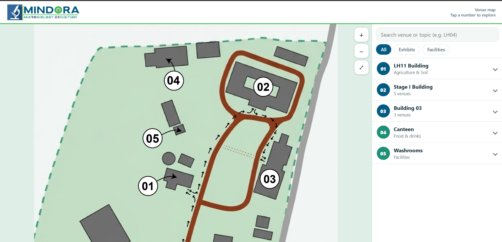

<div align="center">


<br>


<br><br>

### 🧫 Your Interactive Guide to the MINDORA Microbiology Exhibition

[](https://mindora.publicvm.com/)


<a href="https://mindora.publicvm.com/">
  
</a>

</div>


## 📸 Preview

<div align="center">



<sub><i>Campus map with numbered buildings, plus a searchable venue list beside it.</i></sub>

</div>


## 📊 The Exhibition at a Glance

<div align="center">

| 🏛️ **3** | 🔬 **9** | 🧪 **8** | 🍽️ **1** | 🚻 **1** |
|:-:|:-:|:-:|:-:|:-:|
| Exhibit buildings | Exhibit venues | Microbiology fields | Canteen | Washroom block |

</div>

Nine venues are spread across three buildings. They cover the main branches of microbiology, from the soil under our feet to life beyond Earth.


## 🧭 Plan Your Visit

The arrows on the map show the suggested walking route. Start at the bottom, follow the main road north, then loop back down past the last building.

```text
   START                                                         
     │                                                           
     ▼                                                           
  ┌────────┐      ┌──────────────────┐      ┌─────────────┐      
  │ 01     │ ───▶ │ 02               │ ───▶ │ 03          │      
  │ LH11   │      │ Stage I Building │      │ Building 03 │      
  │ 1 venue│      │ 5 venues         │      │ 3 venues    │      
  └────────┘      └──────────────────┘      └─────────────┘      
                                                                 
   ☕ 04 Canteen and 🚻 05 Washrooms are on the west side of the grounds
```

| Stop | Building | Venues | Suggested time* |
|:-:|----------|:-:|:-:|
| 🟢 **01** | LH11 Building | 1 | 15–20 min |
| 🟢 **02** | Stage I Building | 5 | 60–75 min |
| 🟢 **03** | Building 03 | 3 | 40–50 min |
| ☕ **04** | Canteen | rest stop | as you like |
| 🚻 **05** | Washrooms | – | – |

<sub>*A rough guide to help you plan. Take as long as you like at each venue.</sub>


## 🔬 Exhibit Venues

### 🌱 01 · LH11 Building

| Venue | Theme |
|:-:|-------|
| `LH11` | **Agriculture & Soil Microbiology** |

Explore the tiny organisms that keep soil fertile: nitrogen-fixing bacteria, helpful fungi and the microbes that feed our crops.

---

### 🎓 02 · Stage I Building

Five venues, visited in this order:

| Order | Venue | Theme |
|:-:|:-:|-------|
| ➊ | `ZOO Lab` | **Microbiology** |
| ➋ | `BOT Lab` | **Practical Session** (hands-on) |
| ➌ | `LH04` | **Astromicrobiology** |
| ➍ | `LH02` | **Industrial Microbiology** |
| ➎ | `LH01` | **Environmental & Water Microbiology** |

---

### 🏥 03 · Building 03

Three venues, visited in this order:

| Order | Venue | Theme |
|:-:|:-:|-------|
| ➊ | `LH07` | **Medical Microbiology** |
| ➋ | `LH09` | **Food Microbiology** |
| ➌ | `LH08` | **Biotechnology & Molecular Microbiology** |


## 🔎 Quick Find: Every Venue by Code

| Code | Theme | Building | Map # |
|:-:|-------|----------|:-:|
| `BOT Lab` | Practical Session | Stage I Building | 02 |
| `LH01` | Environmental & Water | Stage I Building | 02 |
| `LH02` | Industrial Microbiology | Stage I Building | 02 |
| `LH04` | Astromicrobiology | Stage I Building | 02 |
| `LH07` | Medical Microbiology | Building 03 | 03 |
| `LH08` | Biotech & Molecular Microbiology | Building 03 | 03 |
| `LH09` | Food Microbiology | Building 03 | 03 |
| `LH11` | Agriculture & Soil | LH11 Building | 01 |
| `ZOO Lab` | Microbiology | Stage I Building | 02 |


## 🧬 What You Will Discover

<table>
<tr>
<td width="33%" valign="top">

#### 🌱 Agriculture & Soil
How microbes build healthy soil, help plants grow and reduce the need for chemical fertilisers.

</td>
<td width="33%" valign="top">

#### 🚀 Astromicrobiology
Can life survive in space? See how scientists study microbes in extreme environments and ask whether life exists elsewhere.

</td>
<td width="33%" valign="top">

#### 🏭 Industrial Microbiology
Microbes at work: producing medicines, enzymes, biofuels and everyday products at scale.

</td>
</tr>
<tr>
<td valign="top">

#### 💧 Environmental & Water
How microbes clean water, break down waste and tell us how healthy an ecosystem is.

</td>
<td valign="top">

#### 🏥 Medical Microbiology
The science of infection: bacteria, viruses and fungi, how they cause disease and how we fight back.

</td>
<td valign="top">

#### 🍞 Food Microbiology
The good, the bad and the delicious: fermentation, food safety and how microbes shape what we eat.

</td>
</tr>
<tr>
<td valign="top">

#### 🧪 Biotech & Molecular
Genes, DNA and modern lab techniques that are changing medicine and research.

</td>
<td valign="top">

#### 🔬 Microbiology (ZOO Lab)
A close look at the microscopic world and the organisms that live in it.

</td>
<td valign="top">

#### 🥼 Practical Session (BOT Lab)
Get hands-on. Try the techniques yourself and see the science up close.

</td>
</tr>
</table>


## 🎯 Pick Your Path

| If you are interested in... | Head to |
|-----------------------------|---------|
| 🌾 Farming and the environment | `LH11` → `LH01` |
| 🚀 Space and extreme life | `LH04` |
| 💊 Health and disease | `LH07` → `LH08` |
| 🍽️ Food and nutrition | `LH09` |
| 🏭 Careers in industry | `LH02` → `LH08` |
| 🧑‍🔬 Trying experiments yourself | `BOT Lab` |
| 🔭 The basics of microbiology | `ZOO Lab` |


## 📱 Using the Online Map

Open **https://mindora.publicvm.com/** on your phone and you can:

- 🔢 **Tap any numbered circle** on the map to see what is inside that building
- 📍 **Watch the pulsing pin** guide you to the exact spot
- 🔎 **Search** by venue code such as `LH04`, or by topic such as *medical*
- 🏷️ **Filter** the list to show only **Exhibits** or **Facilities**
- 🤏 **Pinch to zoom** and drag to move around the grounds
- ⤢ **Reset** the view at any time to see the whole map

## ❓ Visitor FAQ

<details>
<summary><b>Where do I start?</b></summary>
<br>
Begin at <b>01 (LH11 Building)</b> and follow the arrows on the map north to Stage I, then on to Building 03.
</details>

<details>
<summary><b>Where can I get food and drink?</b></summary>
<br>
The <b>Canteen (04)</b> is on the north-west side of the grounds, a short walk from the Stage I Building.
</details>

<details>
<summary><b>Where are the washrooms?</b></summary>
<br>
<b>Washrooms (05)</b> are in the middle-west of the grounds, a short walk from LH11.
</details>

<details>
<summary><b>I can't find a venue. What do I do?</b></summary>
<br>
Type its code (for example <code>LH09</code>) into the search box. The map will show you which building it is in.
</details>

<details>
<summary><b>Is there a hands-on activity?</b></summary>
<br>
Yes. The <b>BOT Lab Practical Session</b> in the Stage I Building lets you try things yourself.
</details>

<details>
<summary><b>Do I need to install anything?</b></summary>
<br>
No. The map works in any phone or computer browser.
</details>


<div align="center">

### 🧬 MINDORA – Microbiology Exhibition

*Explore. Discover. Connect.*

<a href="https://mindora.publicvm.com/"><b>Open the Venue Map →</b></a>

</div>
